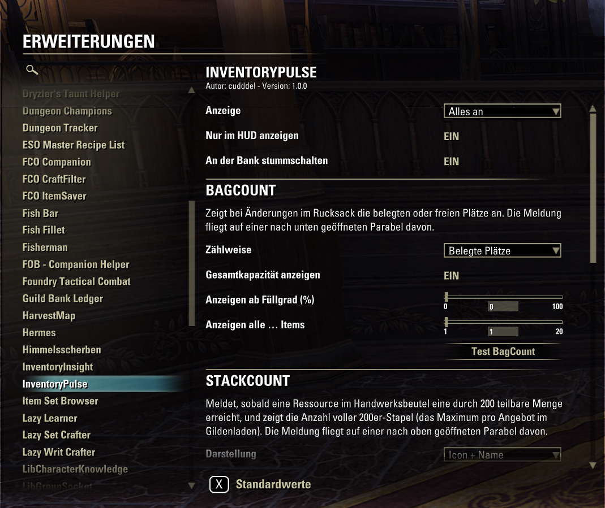

# InventoryPulse

An addon for The Elder Scrolls Online that shows short messages in the middle of the screen. They fade in and then fly away in an arc.

## Features

**BagCount**: Whenever the number of items in your backpack changes, you see how many slots are used (or free), e.g. `161/215`, or as a percentage, e.g. `75% full`.
- The color changes when only 15 or 5 slots are left, and you see "Inventory full!" when nothing is left
- Optional: show only from a certain fill level, or only every *n* items
- Optional: the font grows with the fill level

**StackCount**: Whenever a material in the craft bag (ESO Plus) reaches 200, 400, 600 …, you see its icon, its name and the number of full 200 stacks, e.g. `Rubedite Ingot: 7×200`, together with an optional sound. Handy if you sell full stacks in a guild store. StackCount also watches full stacks in the backpack, e.g. potions, soul gems or lockpicks, which never go into the craft bag. Without ESO Plus, only the backpack is watched.

**Customizable**: font, size, outline, opacity, colors, flight path (width, height, speed, distance), shrinking during flight, HUD-only display and muting at the bank.

## Installation

Install via [Minion](https://minion.mmoui.com/) (search for "InventoryPulse") or download it from [ESOUI](https://www.esoui.com/downloads/info5012-InventoryPulse.html). You can also take the ZIP from [Releases](https://github.com/cudddel-spec/InventoryPulse/releases) and extract it into
`Documents\Elder Scrolls Online\live\AddOns\`.

Optional libraries:
- [LibAddonMenu-2.0](https://www.esoui.com/downloads/info7-LibAddonMenu.html) for the settings menu
- [LibMediaProvider](https://www.esoui.com/downloads/info56-LibMediaProvider.html) for more fonts

## Usage

- Open the settings under **Settings → Add-ons → InventoryPulse**
- In chat, `/ipulse help` lists all commands with their current values

## Languages

English and German. Translations are welcome: copy `lang/en.lua` to `lang/<language>.lua` (for example `fr.lua`), translate the texts and open a pull request or an issue.

## Development

- The repository does **not** live in the `AddOns` folder: Minion replaces the whole addon folder on every update
  (including `.git`, `docs`, `tools`). `python tools/deploy.py [AddOns folder]` copies the game files to
  `AddOns/InventoryPulse` for testing (default: `%ESO_ADDONS%` or `D:\Dokumente\Elder Scrolls Online\live\AddOns`), then `/reloadui`.
- `python tools/build_release.py` builds `dist/InventoryPulse-<version>.zip`, which contains only the files players need.
- `docs/` holds the changelog, the ESOUI description and the screenshots.

**AI disclosure:** The code of this addon was written with the help of an AI assistant (Claude by Anthropic).
The author reviewed it, tested it in-game and is responsible for it.

## License

[MIT](LICENSE)
